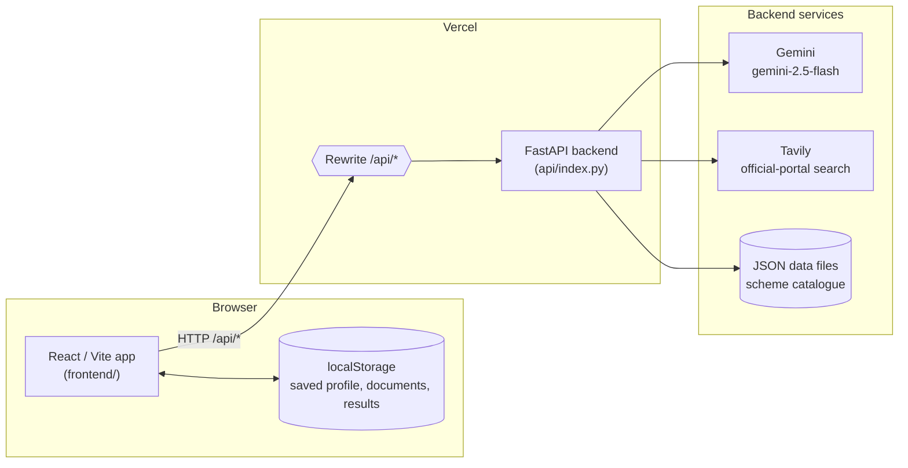
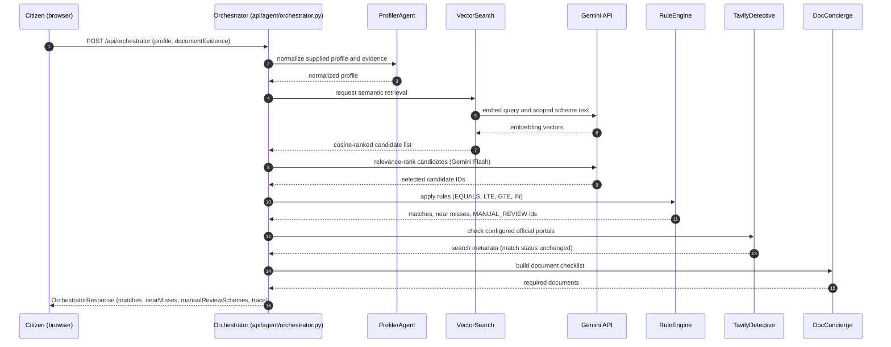

# JanKalyan AI – find welfare schemes you may qualify for

JanKalyan AI helps a citizen describe their situation in plain language or through a form, then shows welfare schemes they may qualify for, the documents they will need, and the official portals to apply on.

> **Hackathon prototype.** This is a prototype. It does not verify documents and does not decide eligibility. Results are "likely eligible" or "needs review", never a guarantee. Only the government department can sanction benefits.

---

## Table of contents

- [Features](#features)
- [Architecture](#architecture)
- [Agentic workflow](#agentic-workflow)
- [API reference](#api-reference)
- [Project structure](#project-structure)
- [Getting started](#getting-started)
- [Testing](#testing)
- [Deployment](#deployment)
- [Known limitations](#known-limitations)
- [Licence and disclaimer](#licence-and-disclaimer)

---

## Features

- **Multilingual experience:** the interface supports English, Kannada, Hindi, Tamil, Malayalam and Telugu. Scheme titles are available in all six languages; benefit and application text may fall back to English where translations are unavailable.
- **Gemini is used to find and rank schemes relevant to someone’s situation** through embeddings and relevance ranking. Eligibility status is a separate step: deterministic rules evaluate the small set of schemes with modeled rules, while most catalog entries are marked `MANUAL_REVIEW`. Gemini does not decide whether a citizen is legally eligible.
- **Document checklist** per scheme, with authority, estimated cost and turnaround time.
- **Document OCR.** Gemini extracts a limited set of fields from an uploaded income, residence, education, caste or land document and checks printed expiry dates. Identity and bank documents are rejected.
- **Scheme Q&A chat** that answers questions about a scheme, with citations.
- **Official-portal search** through Tavily, restricted to configured official domains. Search failures return no substitute results.
- **Offline app shell.** The service worker caches the app shell and previously fetched GET responses. Backend operations and uploads still require a network connection.
- **Field Worker and passbook views** for assisted use and for reviewing saved results.

---

## Architecture



The app has no database. Scheme data is stored in JSON files, and the citizen's working data is kept in browser `localStorage`.
Intake text is sent to Gemini when configured. Document images are sent for OCR after the user starts the pre-flight check. Tavily receives the generated official-portal search query when its API key is configured.

### Components

Paths in this table are relative to `jankalyan-ai/`.

| Component | Folder path | Role |
|---|---|---|
| Frontend (React + Vite) | `frontend/` | Application opens at `/`; marketing landing page is available at `/welcome` |
| API entrypoint | `api/index.py` | FastAPI routes and CORS setup |
| API contract models | `api/models.py` | Pydantic request and response models |
| Agent orchestrator | `api/agent/orchestrator.py` | Runs the fixed pipeline and the LLM intake and chat calls |
| Tools | `api/agent/tools.py` | Scheme catalogue loading, vector search, Tavily calls |
| Document OCR | `api/agent/ocr.py` | Gemini-based document field extraction |
| Scheme data | `api/` (JSON data files) | Scheme definitions, rules and required documents |
| Backend tests | `api/tests/` | 27 `unittest` tests |
| Architecture notes | `ARCHITECTURE_AND_WORKFLOW.md` | Longer design write-up |

---

## Agentic workflow

The workflow is a **fixed pipeline, not autonomous agents.** The orchestrator calls each step in the same order every time. No agent chooses its own next step or tools.

The pipeline runs in this order:

1. **ProfilerAgent** builds the citizen profile from the intake data.
2. **VectorSearch** embeds the search intent and eligible state/All-India scheme text with Gemini embeddings, then ranks by cosine similarity.
   - **GeminiReranker** uses `gemini-2.5-flash` to select and order relevant candidates. Discovery fails closed if embedding or reranking fails.
3. **RuleEngine** applies deterministic rules. The operators are `EQUALS`, `LTE`, `GTE` and `IN`. Entries marked `MANUAL_REVIEW` are returned separately rather than treated as automated eligibility matches.
4. **TavilyDetective** checks configured official portals and records search metadata in the execution trace. It does not change match status or add search-result cards to discovery.
5. **DocConcierge** builds the document checklist for each scheme.



### Where the LLM is used

Gemini services are used for intake profile extraction, multilingual embeddings (`models/gemini-embedding-001`), candidate relevance ranking, policy chat and document OCR (generative calls use `gemini-2.5-flash`). Eligibility pass/fail is decided by deterministic rules where available, not by Gemini.

### Fallbacks

| Situation | Fallback | Effect |
|---|---|---|
| Gemini intake fails | `HEURISTIC_FALLBACK` | Profile is extracted with rule-based text matching. The response reports this in `extractionMode`. |
| Chat without a `schemeId`, or Gemini unavailable | `DETERMINISTIC_FALLBACK` | Answer is built from the stored scheme text. The response reports this in `mode`. |
| Gemini embeddings or relevance ranking fail | HTTP 503 | Discovery stops rather than returning an unranked or unfiltered list. |
| Tavily unavailable | Empty result set with a note | No substitute or fabricated search results are returned. |
| Backend unreachable | No discovery fallback | Intake, discovery and OCR surface errors; previously cached app-shell and GET responses may still be available offline. |

---

## API reference

Base path: `/api`. All request and response bodies are JSON unless noted. Field names below are the ones defined in `api/models.py` and `api/index.py`.

### Endpoints

| Method | Path | Purpose |
|---|---|---|
| GET | `/api/health` | Service status, number of schemes loaded, guardrail text |
| GET | `/api/schemes` | All schemes in the knowledge base |
| POST | `/api/intake` | Turn plain-language or form text into a structured profile |
| POST | `/api/orchestrator` | Run the pipeline: match schemes, return near misses, manual-review schemes and trace |
| POST | `/api/chat` | Answer a policy question, optionally about one scheme |
| POST | `/api/document-ocr` | Extract limited fields from an uploaded document (multipart) |
| GET | `/api/tavily-search` | Search official portals for notices and deadline extensions |

### POST /api/intake

Request:

```json
{
  "text": "I am a student from Mandya, my family earns about 1.2 lakh a year",
  "language": "en"
}
```

Response (abbreviated):

```json
{
  "profile": {
    "state": "Karnataka",
    "district": "Mandya",
    "familyAnnualIncome": 120000.0
  },
  "extractionMode": "HEURISTIC_FALLBACK",
  "defaultedFields": ["age", "gender", "landHoldingAcres"]
}
```

`profile` contains fields extracted from the text. `defaultedFields` lists `CitizenProfile` fields that were not supplied and therefore use model defaults.

### POST /api/orchestrator

Request. `profile` is a partial `CitizenProfile`; missing fields take defaults. `documentEvidence` is optional.

```json
{
  "profile": {
    "name": "Sample Citizen",
    "age": 21,
    "state": "Karnataka",
    "district": "Mandya",
    "familyAnnualIncome": 120000.0,
    "occupation": "STUDENT"
  },
  "documentEvidence": [
    {
      "documentId": "doc-0001",
      "category": "income",
      "validityStatus": "CURRENT",
      "extracted": {
        "documentCategory": "income",
        "documentType": "INCOME_CERTIFICATE",
        "issueDate": "2025-01-10",
        "expiryDate": "2026-01-09",
        "annualIncomeINR": 150000
      },
      "savedAt": "2025-02-01T10:00:00Z"
    }
  ]
}
```

- `validityStatus` is one of `CURRENT`, `EXPIRED`, `REVIEW_REQUIRED`, `TYPE_MISMATCH`.
- If a `CURRENT` income document has `extracted.annualIncomeINR`, the server uses the newest one as `familyAnnualIncome` for rule matching.
- Evidence is supplied by the client and is not verified on the server.

Response (abbreviated; the lists are shown empty here):

```json
{
  "profile": {
    "name": "Sample Citizen",
    "age": 21,
    "state": "Karnataka",
    "district": "Mandya",
    "familyAnnualIncome": 120000.0,
    "occupation": "STUDENT"
  },
  "matches": [],
  "nearMisses": [],
  "manualReviewSchemes": [],
  "trace": [],
  "defaultedFields": ["gender", "landHoldingAcres", "landType"]
}
```

- `matches` and `nearMisses` are lists of `EligibilityMatchResult` objects: `schemeId`, `scheme`, `status`, `matchPercentage`, `passedRules`, `failedRules`, `nearMissRemediation`.
- `trace` is a list of steps: `stepNumber`, `timestamp`, `agentRole`, `action`, `input`, `output`, `durationMs`.
- The server returns HTTP 503 if the scheme-discovery AI is unavailable.

### POST /api/chat

Request:

```json
{
  "question": "Who can apply for this scheme?",
  "schemeId": "EXAMPLE-SCHEME-01",
  "language": "en"
}
```

Response:

```json
{
  "answer": "Students from families below the stated income limit may apply. Check the official portal for current rules.",
  "sources": [],
  "mode": "DETERMINISTIC_FALLBACK"
}
```

`mode` is `GEMINI` when the answer comes from the model, and `DETERMINISTIC_FALLBACK` otherwise. `sources` is a list of citation objects.

### POST /api/document-ocr

Multipart form request:

| Field | Type | Notes |
|---|---|---|
| `file` | file | JPG, PNG, WEBP, HEIC or PDF, up to 10 MB |
| `category` | form text | One of `identity`, `income`, `residence`, `education`, `caste`, `land`, `bank`, `other`. `identity` and `bank` are rejected with HTTP 400. |

Example with curl (run from a shell on any machine):

```bash
curl -X POST http://localhost:8000/api/document-ocr \
  -F "file=@sample-income.jpg;type=image/jpeg" \
  -F "category=income"
```

Response:

```json
{
  "fileName": "document",
  "extracted": {
    "documentCategory": "income",
    "documentType": "INCOME_CERTIFICATE",
    "issueDate": "2025-01-10",
    "expiryDate": "2026-01-09",
    "annualIncomeINR": 150000
  },
  "validity": {
    "status": "CURRENT",
    "detail": "The printed expiry date is 2026-01-09."
  },
  "checks": {
    "documentCategory": { "status": "PASS" },
    "expiryDate": { "status": "CURRENT" },
    "annualIncomeINR": { "status": "EXTRACTED" }
  },
  "issues": [],
  "mode": "GEMINI_VISION",
  "note": "OCR checks only printed information. It does not authenticate the document or replace the issuing authority's validity rules."
}
```

Other HTTP errors: 415 for an unsupported file type, 413 for a file over 10 MB, 503 when `GEMINI_API_KEY` is not set, 502 when OCR fails.

### GET /api/tavily-search

Query parameters: `query` (default `official government welfare schemes`), `schemeId` (optional), `state` (optional).

Example:

```
GET /api/tavily-search?query=income%20certificate%20deadline&schemeId=EXAMPLE-SCHEME-01
```

Response:

```json
{
  "query": "income certificate deadline",
  "results": [],
  "isMock": false,
  "note": "Sample response.",
  "verifiedAt": "2025-02-01T10:00:00Z"
}
```

`isMock` is `true` when live Tavily search is unavailable or failed. In that case, `results` is empty; no placeholder results are substituted.

### GET /api/schemes

Returns the catalog as a JSON array. Records include scheme IDs, localized title fields, state/category, benefit summaries, official sources, eligibility metadata and application/document details. Optional localized benefit and application text is present only where catalog translations exist.

### GET /api/health

Response:

```json
{
  "status": "healthy",
  "service": "JanKalyan AI Agentic Backend",
  "schemesCount": 110,
  "guardrail": "Likely Eligible (Never Guaranteed), Zero Aadhaar Stored"
}
```

---

## Project structure

```
<repository root>/
├── vercel.json                  Vercel services and rewrites
├── jankalyan-ai/
│   ├── api/                      FastAPI backend (index.py, models.py, agent/, tests/)
│   ├── frontend/                 React + Vite app
│   └── ...
└── ARCHITECTURE_AND_WORKFLOW.md  Architecture and workflow notes
```

The `docs` folder is omitted from this tree.

---

## Getting started

Commands below are for Windows (PowerShell or Command Prompt).

### 1. Environment file

```powershell
copy jankalyan-ai\.env.example jankalyan-ai\.env
```

Open `jankalyan-ai\.env` and set:

- `GEMINI_API_KEY`
- `TAVILY_API_KEY`

Never commit `.env` to Git.

### 2. Backend

From the `jankalyan-ai` folder:

```powershell
cd jankalyan-ai
pip install -r api\requirements.txt
set PYTHONPATH=%CD%
uvicorn api.index:app --port 8000
```

In PowerShell, use `$env:PYTHONPATH = (Get-Location).Path` instead of `set PYTHONPATH=%CD%`.

### 3. Frontend

From the `jankalyan-ai\frontend` folder, in a second terminal:

```powershell
cd jankalyan-ai\frontend
npm install
npm run dev
```

The dev server runs on port 3000 and proxies `/api` to port 8000.

### 4. Open the app

- Application: http://localhost:3000/
- Marketing landing page: http://localhost:3000/welcome
- Scheme discovery: http://localhost:3000/discover
- Scheme catalogue: http://localhost:3000/schemes

---

## Testing

**Backend.** From the `jankalyan-ai` folder, set `PYTHONPATH` to the `jankalyan-ai` folder as in step 2, then run:

```powershell
python -m unittest discover -s api\tests -v
```

This runs 27 tests.

**Frontend.** From the `jankalyan-ai\frontend` folder:

```powershell
npm run build
```

This runs the TypeScript check and the Vite build.

---

## Deployment

Production app: <https://jankalyan-ai.vercel.app/>

Deploy to Vercel using the repository-root `vercel.json`. It defines two services:

- `api`: `jankalyan-ai/api`, runtime `fastapi`
- `frontend`: `jankalyan-ai/frontend`, runtime `vite`

The top-level rewrite sends `/api/*` to the `api` service and all other paths to the `frontend` service. A frontend-service rewrite sends client-side routes (such as `/schemes` and `/tracker`) to its `index.html` so direct navigation and refresh work.

In the Vercel project settings, add these environment variables:

- `GEMINI_API_KEY`
- `TAVILY_API_KEY`

---

## Known limitations

- Scheme data has official-portal links, but it has no per-rule government source references.
- The catalog currently contains 110 records across All India and five states. 105 are marked `MANUAL_REVIEW`; five have configured rule predicates. Treat all results as guidance and verify current requirements with the issuing authority.
- The citizen profile has no residence-proof field, and bank details are limited to an Aadhaar-bank-linked flag (`isAadhaarBankLinked`). Age, gender and disability percentage are present in `CitizenProfile` but may be defaulted when the user does not supply them.
- Document evidence supplied by the client is not verified on the server.
- There is no authentication and no rate limiting.
- CORS allows all origins.
- There is no consent screen before data is sent to Gemini or Tavily.
- Offline support is limited to the cached app shell and previously fetched GET responses; POST operations require a network connection.
- Scheme administration is a disabled placeholder. The tracker supports discovery and document-readiness stages; later application-status actions are not implemented.

---

## Licence and disclaimer

Licence: not specified.

JanKalyan AI is a hackathon prototype. It shows possible matches and is not an eligibility decision. Only the government department can sanction benefits. Check every scheme on its official portal before you apply.
